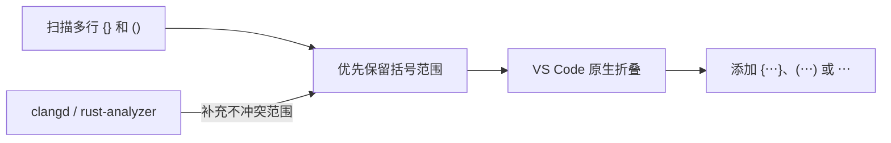

# Inline Brace Folding

在 VS Code 里把可安全折叠的多行 `{}` 和 `()` 显示为 `{⋯}` 和 `(⋯)`。底色只在占位符上，点击省略号或原生折叠箭头可以展开；插件不修改源码。

## 安装和启用

用 `Extensions: Install from VSIX...` 安装 `inline-brace-folding-0.3.1.vsix`。在**用户设置**或**项目的 `.vscode/settings.json`** 里选中本插件：

```json
{
  "editor.defaultFoldingRangeProvider": "flamekm.inline-brace-folding",
  "editor.foldingStrategy": "auto",
  "editor.foldingHighlight": false
}
```

上述写法适用于所有语言。只想在特定语言启用，就把选项放进对应语言的设置块（如 `"[cpp]"`、`"[rust]"`）；已有语言块时，在原块里改，避免旧设置覆盖。改完后展开再折叠，必要时执行 `Developer: Reload Window`。

## 折叠规则

- **括号优先。** 本插件识别多行 `{}` 和 `()`，不为单行括号或 `[]` 新建折叠。安全的闭合行会被整个折入，即使没有文件末尾换行；`);`、`};` 里的标点保留在括号后。扫描器不是各语言的完整解析器，遇到语言特有的字符串、注释或其他语法时可能跳过或识别不准。
- **其他范围只显示 `⋯`。** clangd（C/C++）和 rust-analyzer（Rust）提供的注释、导入及其他不冲突范围保留原有边界。同一行或交叉范围发生冲突时，保留本插件的括号范围。语言服务返回空列表也不会取消括号折叠。
- **默认提供者是独占设置，不是 VS Code 的合并优先级。** 选本插件后，不会自动保留尚未适配的语言引擎或 VS Code 缩进折叠。删除该设置即可恢复 VS Code 自选提供者；C、C++ 和 Rust 仍保留兼容模式，但不保证本插件的范围优先。
- **不隐藏共享行上的其他代码。** 如果闭合行还含 `} else {`、`) {`、注释或表达式，或开括号后还有代码，VS Code 的按行折叠无法只隐藏该行的一部分。这时保留实际闭合行，可折叠的中间部分只显示 `⋯`。
- **占位符靠可见行推断。** VS Code 没有公开的折叠状态接口。视口边缘或打开已折叠的文件时，有可能只看到原生 `⋯`；把折叠头滚到视口内、展开再折叠可以重新推断。主题色 `inlineBraceFolding.placeholderBackground` 可调整占位符底色。



## 开发与验证

打开仓库根目录 `vscode-expansion/`，在 `inline-brace-folding/` 执行 `npm ci`。F5 选 `Debug Inline Brace Folding` 可隔离其他扩展；选 `Debug Inline Brace Folding with Language Extensions` 可与已安装的 clangd 和 rust-analyzer 联调。在调试窗口打开实际项目，并在该项目配置本插件为默认提供者。

```sh
npm test
npm run test:vscode  # 本机图形版 VS Code；可用 VSCODE_TEST_BINARY 指定可执行文件
npx --yes @vscode/vsce@4.1.1 package --no-dependencies --allow-missing-repository --skip-license
```
