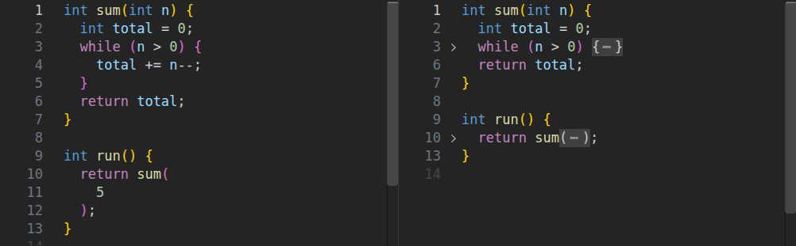

# Inline Brace Folding

[](https://code.visualstudio.com/) [](LICENSE)

一个让 VS Code 把多行花括号和圆括号折成 **`{⋯}`** 和 **`(⋯)`** 的扩展。收起函数体、循环和长参数列表后，仍能看出括号边界；折叠只改变显示，不修改源码。



*同一段 C++ 代码，左侧展开，右侧折叠。*

## 功能

- **保留括号和标点。** 安全的闭合行会被折入占位符，同时保留 `);`、`};` 等结尾。单行括号和 `[]` 不新增折叠。
- **沿用原生交互。** 用侧栏箭头或 VS Code 的折叠命令收起，点击省略号或侧栏箭头展开。
- **兼容语言服务。** 选为默认提供者后，可补充 clangd（C/C++）和 rust-analyzer（Rust）提供的不冲突折叠范围，例如注释和导入；与括号范围冲突时，优先保留括号范围。

## 从源码安装

需要 VS Code **1.99+** 和 Node.js **22+**。

```sh
npm ci
npx --yes @vscode/vsce@4.1.1 package --no-dependencies
code --install-extension ./inline-brace-folding-0.3.1.vsix
```

也可以在 VS Code 命令面板运行 `Extensions: Install from VSIX...`，选择生成的 `.vsix` 文件。

在**用户设置**或项目的 `.vscode/settings.json` 中选中本扩展：

```json
{
  "editor.defaultFoldingRangeProvider": "flamekm.inline-brace-folding",
  "editor.foldingStrategy": "auto",
  "editor.foldingHighlight": false
}
```

只想在某种语言里启用？把上面的选项放进对应的语言设置块，例如 `"[cpp]"` 或 `"[rust]"`。修改后可以先展开再折叠；必要时运行 `Developer: Reload Window`。

## 已知限制

- **折叠按行进行。** 对于 `} else {` 之类的共享行，保留原行，不会把两个分支拼成一行。闭合行上还有其他代码时，只收起能安全隐藏的中间行。
- **默认提供者不是叠加设置。** 选用本扩展后，不会自动合并尚未适配的语言服务或 VS Code 缩进折叠。删掉 `editor.defaultFoldingRangeProvider` 可恢复 VS Code 的默认选择；C、C++ 和 Rust 仍有兼容模式，但不保证本扩展的范围优先。
- **占位符根据可见行推断。** 视口边缘或打开已折叠文件时，可能只看到原生 `⋯`。将折叠头滚到视口内，再展开并折叠即可重新推断。主题设置 `inlineBraceFolding.placeholderBackground` 可调整占位符底色。
- **不做完整的语言解析。** 扫描器在遇到特定语言的字符串、注释或其他语法时，可能跳过或误判括号。

## 开发与贡献

```sh
npm ci
npm test             # 编译并运行单元测试
npm run test:vscode  # 在图形版 VS Code 中运行集成测试
```

集成测试默认调用 `code`，可通过 `VSCODE_TEST_BINARY` 指定其它可执行文件。欢迎提 Issue 或 PR；反馈折叠异常时，请附上语言、最小代码片段、VS Code 版本以及启用的语言扩展。

## 许可证

本项目使用 [MIT License](LICENSE)。
